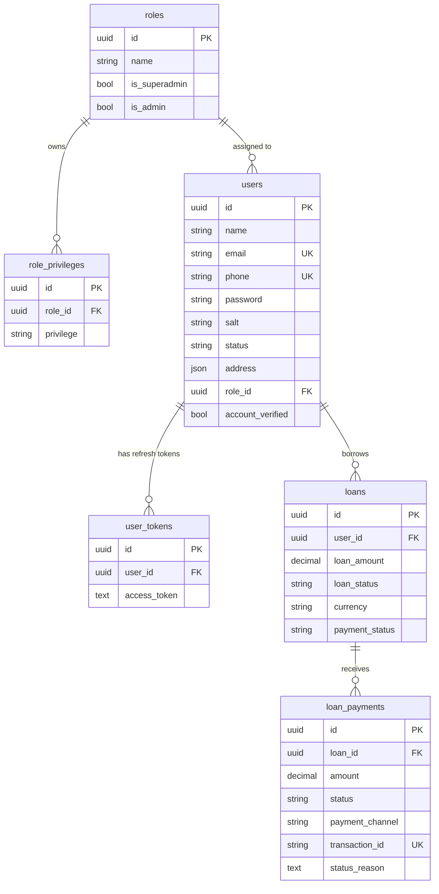
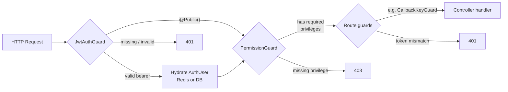
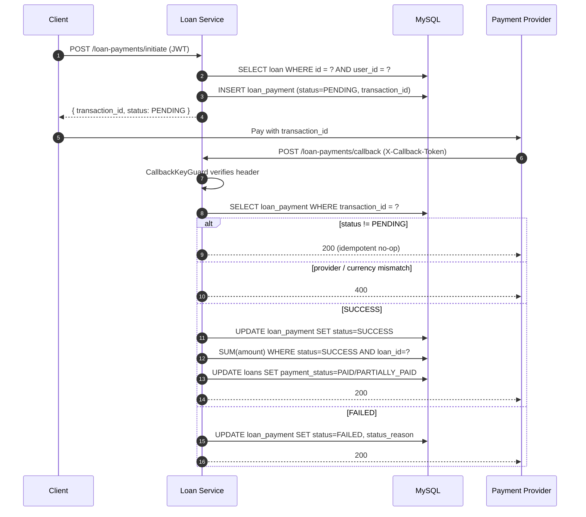

# Loan Service

A NestJS + MySQL + Redis service that manages users, roles with fine-grained
privileges, loans, and provider-driven loan payments.

## Stack

- **NestJS 11** — modular HTTP layer, DI, guards, Swagger.
- **Sequelize + sequelize-typescript** — typed models over MySQL.
- **Umzug** — versioned, timestamped migrations under
  `src/database/migrations/`.
- **Redis** — OTP storage, auth-user cache, OTP resend cooldowns, used-token
  blacklist for password reset.
- **JWT (access + refresh)** — bearer auth for all private routes.
- **bcryptjs** — password hashing with per-user salt.
- **class-validator / class-transformer** — DTO validation.

## Data model



### Tables

| Table              | Columns                                                                                                                   |
| ------------------ | ------------------------------------------------------------------------------------------------------------------------- |
| `roles`            | `id`, `name`, `is_superadmin`, `is_admin`, timestamps                                                                     |
| `role_privileges`  | `id`, `role_id` (FK → roles), `privilege`, timestamps                                                                     |
| `users`            | `id`, `name`, `email` (unique), `password`, `salt`, `phone` (unique), `status`, `address` (JSON, nullable), `role_id` (FK → roles), `account_verified`, timestamps |
| `user_tokens`      | `id`, `user_id` (FK → users), `access_token`, timestamps — refresh token store                                            |
| `loans`            | `id`, `user_id` (FK → users), `loan_amount` DECIMAL(15,2), `loan_status` ENUM(PENDING/APPROVED/REJECTED), `currency`, `payment_status` ENUM(PENDING/PAID/PARTIALLY_PAID/OVERDUE), timestamps |
| `loan_payments`    | `id`, `loan_id` (FK → loans), `amount` DECIMAL(15,2), `status` ENUM(PENDING/SUCCESS/FAILED), `payment_channel` ENUM(MTN/AIRTEL/BANK), `transaction_id` (unique), `status_reason` (nullable), timestamps |

### Why privileges live on the role

A user has exactly one `role_id`. The role owns a set of
`role_privileges`, each one a string key from `AllPrivileges`
(`CAN_CREATE_USER`, `CAN_APPROVE_LOAN`, …). The `PermissionGuard` reads
those strings off `req.user.priviles` at request time and matches them
against each route's `@RequirePermissions(...)` metadata — so authorisation
rules live next to the controllers they protect, not in a central table.

## Module layout

```
src/
├── app.module.ts             ← wires modules + registers global guards
├── common/
│   ├── base.repository.ts    ← paginated CRUD base
│   ├── guards/
│   │   ├── jwt-auth/         ← bearer-token guard (@Public() to bypass)
│   │   ├── permission-guard/ ← @RequirePermissions(...) gate
│   │   └── callback-key/     ← X-Callback-Token for provider webhooks
│   └── services/             ← cross-cutting services (e.g. report cache)
├── config/                   ← env-backed config object
├── constants/                ← shared enums (statuses, privileges)
├── database/
│   ├── database.module.ts
│   ├── sequelize.ts          ← standalone Sequelize instance for CLI tools
│   ├── tables.ts             ← single source of truth for table names
│   ├── migration-runner.ts   ← Umzug entrypoint for CLI migrations
│   ├── migrations/           ← timestamped up/down migrations
│   ├── models/               ← sequelize-typescript model classes
│   └── seeders/              ← superAdmin + privileges seeders
├── helpers/                  ← userHelper (tokens, OTP), emailHelper, redis, logger
├── modules/
│   ├── auth/                 ← login, OTP verify, verify-account, forgot/reset password, refresh
│   ├── users/                ← CRUD + change password/status/role
│   ├── roles/                ← CRUD + privilege set
│   ├── privileges/           ← list privileges available to a role
│   ├── loans/                ← loan CRUD
│   ├── loan-payments/        ← initiate + provider callback
│   └── utility/              ← password hashing service
└── types/                    ← AuthUser and shared type contracts
```

## Request pipeline

Every HTTP request runs through two global guards (registered as
`APP_GUARD` in `app.module.ts`) plus any route-level guards:

1. **`JwtAuthGuard`** — rejects missing/invalid bearer tokens. Routes
   decorated with `@Public()` skip it. On a cache miss, rebuilds the
   `AuthUser` from `users` + `role_privileges` and caches it in Redis
   for one hour.
2. **`PermissionGuard`** — compares `AuthUser.priviles` (set by the JWT
   guard) against the route's `@RequirePermissions(...)` metadata.
3. **Route-level guards** — e.g. `CallbackKeyGuard` on
   `POST /loan-payments/callback`, which does a constant-time comparison
   of `X-Callback-Token` against `LOAN_PAYMENT_CALLBACK_TOKEN`.



## Auth flow

1. `POST /auth/login` — email + password. If the user is `ACTIVE`, an OTP
   is written to Redis and emailed. Returns a `userId`.
2. `POST /auth/verify-otp` — `{ userId, otp }`. Issues an access token
   (1h) and refresh token (30d). The refresh token is persisted in
   `user_tokens`. The `AuthUser` payload is cached in Redis for use by
   `JwtAuthGuard`.
3. `POST /auth/refresh` — exchanges the stored refresh token for a new
   access token.
4. `POST /auth/forgot-password` → `/auth/reset-password` — signed token
   emailed, one-time use enforced via a Redis entry keyed by the token
   hash.
5. `POST /auth/verify-account` — flips `account_verified`, `status = ACTIVE`,
   sets the user's password.

## Loan payment flow

1. **Initiate** — `POST /loan-payments/initiate` (JWT required).
   - Loan must exist, belong to the caller, be `APPROVED`, and not
     already `PAID`.
   - Server generates a UUID `transaction_id` and inserts a
     `loan_payments` row with `status = PENDING`.
   - Returns `{ id, transaction_id, status, amount, payment_channel }`
     so the client can hand the transaction off to the provider.
2. **Callback** — `POST /loan-payments/callback` (public, guarded by
   `CallbackKeyGuard` via `X-Callback-Token`).
   - Looks up the payment by `transaction_id`.
   - Validates `provider === payment_channel` and
     `currency === loan.currency`.
   - Writes the final `status` (`SUCCESS` or `FAILED`) and
     `status_reason` (optional) onto the payment row.
   - On `SUCCESS`: recomputes the sum of successful payments for the
     loan and flips `loans.payment_status` to `PAID` (sum ≥ loan amount)
     or `PARTIALLY_PAID`.
   - Idempotent: a callback for a non-`PENDING` payment is a no-op 200.



## Migrations and seeders

- Migrations live in `src/database/migrations/` with
  `YYYY.MM.DDTHH.MM.SS.*.migration.ts` filenames and are discovered by
  Umzug.
- Seeders run via `npm run db:seed` and execute inside Sequelize
  transactions:
  - `SuperAdminSeeder` — `findOrCreate` on a role where
    `is_superadmin = true`, then creates the default admin user from
    `DEFAULT_ORGANIZATION_ADMIN_USER_*` env vars (hashed with bcrypt,
    `status = ACTIVE`, `account_verified = true`).
  - `PrivilegesSeeder` — wipes and re-attaches every privilege from
    `AllPrivileges` to the super-admin role. Runs after `SuperAdminSeeder`.

## Setup

```bash
npm install
cp .env.example .env     # if present — otherwise set the vars below
npm run db:migrate
npm run db:seed
npm run dev
```

### Required env vars

| Variable                                    | Purpose                                            |
| ------------------------------------------- | -------------------------------------------------- |
| `DB_MASTER_HOST` / `_PORT` / `_NAME` / `_AUTH_USERNAME` / `_AUTH_PASSWORD` | MySQL primary connection       |
| `DB_REPLICA1_*`, `DB_REPLICA2_*`            | Optional read replicas                             |
| `REDIS_HOST` / `_PORT` / `_PASSWORD`        | Redis for OTP, auth cache, token blacklist         |
| `JWT_SECRET_KEY`                            | Signs access/refresh/verify/reset tokens           |
| `DEFAULT_ORGANIZATION_ADMIN_USER_NAME` / `_EMAIL` / `_PASSWORD` / `_TELEPHONE` | Seeder uses these to bootstrap the super admin |
| `EMAIL_SMTP_*`                              | Outbound mail for activation / OTP / reset        |
| `FRONTEND_URL`                              | Base URL used in email links                       |
| `LOAN_PAYMENT_CALLBACK_TOKEN`               | Shared secret required by `CallbackKeyGuard` on `POST /loan-payments/callback` |

## Scripts

```bash
npm run dev                  # watch mode
npm run build                # compile to dist/
npm run start:prod           # run compiled server
npm run db:migration:create <name>
npm run db:migrate           # apply pending migrations
npm run db:migrate:down      # roll back the last migration
npm run db:seed              # super-admin + privileges
npm run test
npm run test:e2e
```
